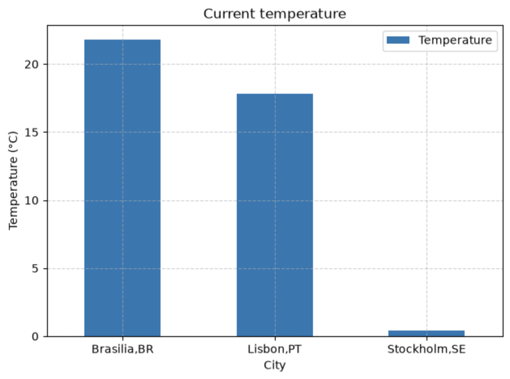
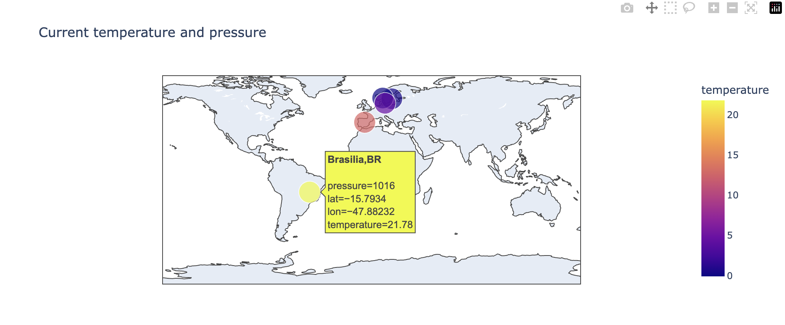

# Open Weather

Python project that uses the OpenWeather API to get the current weather for different countries and show it in charts and maps.

## What it does

- Gets the current temperature for any number of countries.
- Shows the temperatures in a bar chart.
- Shows temperature and pressure on a map. The marker color shows the temperature and the marker size shows the pressure.

## Screenshots

### Temperature bar chart


### Temperature and pressure map


## Setup

1. Install the project and its dependencies:

   ```
   pip install -e .
   ```

2. Get an API key at [openweathermap.org](https://openweathermap.org/api).

3. Create a `.env` file in the project root:

   ```
   API_KEY=your_key_here
   ```

## Usage

Open the notebook in `notebooks/current_weather.ipynb` and run the cells.

Example:

```python
from open_weather.services.temperatures import get_temperatures

get_temperatures("Stockholm,SE", "Brasilia,BR", "Tokyo,JP")
```

Use the format `city,country code` (for example `Brasilia,BR`). A country name alone can match a city with the same name, like Brazil in the USA.

## Project structure

```
src/open_weather/
    api/            API calls (geocoding and current weather)
    services/       functions that organize the data
    visualization/  bar chart and map functions
notebooks/          charts and maps
```